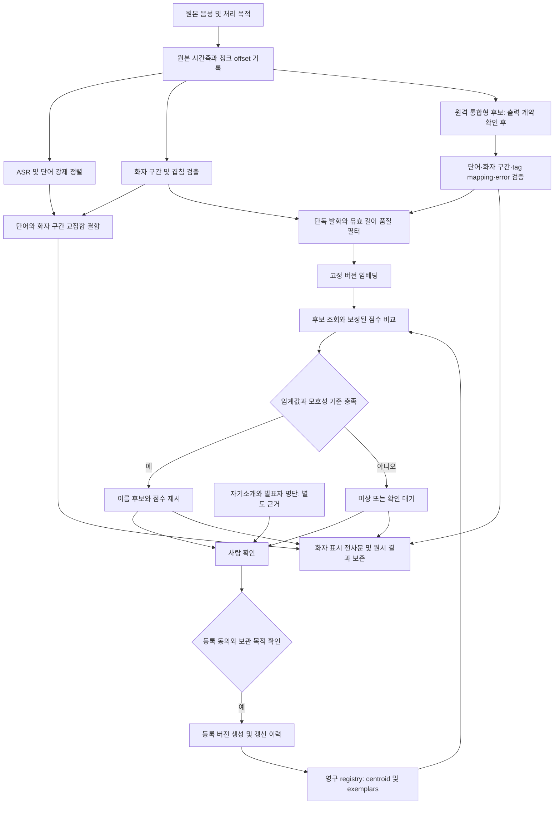

# T2 — 화자 분리와 목소리 등록·재식별

조사 기준일: 2026-11-04. 초기 후보 문헌 확보: 2026-11-04 KST. SQL parser·추가 제시 Nemotron 3.5 원문 확인과 인용 감사: 2026-11-05 KST. 자정 이후 기존 조회 결과를 파일에 보존한 작업은 새 조회로 세지 않았다. 문서의 발행·갱신 시점은 출처별로 적었으며, 날짜 없는 웹 문서를 2026년 11월의 검증된 제품 상태로 일반화하지 않는다.

추가 사용자 제약(2026-11-05 적용): **로컬 30B 모델 실행은 추천에서 제외한다.** Nemotron 3.5 Transcribe 30B는 원격 호스팅의 출력 계약을 검토할 후보로만 유지하며, OpenRouter의 word timestamps·diarization 노출 여부는 미확정이다.

질문: **open-scribe가 녹음 안의 화자를 구분하고, 동의받은 목소리를 저장해 다음 녹음에서 재식별하려면 어떤 구조가 필요한가?**

하위질문은 다섯 개다.

1. 오픈 후보 7개와 호스팅 후보 8개는 무엇을 출력하고 어떤 제약이 있는가?
2. DER·JER·겹침·화자수·Apple Silicon·라이선스·HF 토큰을 어떻게 비교해야 하는가?
3. 단어 시간과 화자 구간을 어떻게 합쳐야 하는가?
4. 여러 등록 클립과 임베딩을 어떻게 저장·보정·갱신해야 하는가?
5. 목소리 생체정보의 수집·보관·삭제에 어떤 법적 검토가 필요한가?

심층 분석은 **① 시간축과 화자 구간의 결합**, **② 영구 화자 등록과 미등록자 거절**의 두 축이다. SQL·법규·후보별 사례는 이 두 축의 적용 조건으로 다룬다. 이 문서는 문헌 조사이며, 모델 실행·성능 실측·설치·가중치 다운로드·유료 호출을 하지 않았다. ASR 자체 성능과 호스팅 가격 상세는 T3·T4의 담당 범위다.

표기: `[추론]`은 문헌에서 도출한 설계 제안이다. `[불명·미발견]`은 읽은 원문 또는 명시한 검색에서 확인하지 못한 항목이며, 기능이 없다는 뜻이 아니다. `[불명·미검색]`은 해당 세부사항을 조사하지 않은 항목이다.

## 요약

- [추론] 파일 안의 익명 화자 번호와 파일을 넘어 유지할 `person_id`를 분리해야 한다. pyannoteAI도 diarization과 등록 voiceprint를 비교하는 identification을 별도 단계로 제공한다[16][17].
- [추론] 로컬 추천은 Community-1과 소형 임베딩·영구 registry를 결합하는 독립형이다. 일반·exclusive 화자 구간을 함께 받을 수 있다[1]. Nemotron 3.5 Transcribe는 원모델에 ASR·화자·단어 정렬 통합 기능이 있지만, 사용자 제약에 따라 원격 호스팅 계약 검토 후보로만 둔다[41]. OpenRouter 출력 지원은 미확정이며, 로컬 추천 후보의 M3 Max 실측도 남아 있다.
- [추론] 영구 등록은 여러 환경의 클립, 품질 필터, 모델 버전, centroid와 원본 exemplars, 미상 판정, 사람 확인을 함께 설계해야 한다. 여러 클립 등록은 Speechmatics의 공식 권고이며, centroid 구성과 갱신 규칙은 이 보고서의 제안이다[25].
- OpenAI의 `gpt-4o-transcribe-diarize`는 공식 문서에 남아 있다[18]. 2026-08-26 공지에서는 2027-02-26 API 종료 예정으로 명시됐다[19]. [추론] 기능 존재와 신규 채택 적합성을 구분해야 한다.
- [추론] 공개 영상의 전사 허용과 목소리 영구 등록의 적법성을 같은 것으로 취급하면 안 된다[35]. 한국 시행령은 특정인을 알아볼 목적으로 기술적으로 생성한 신체·생리·행동 특징 정보를 민감정보 범위에 포함한다[36].

## 문헌 비교 — 심층 축 ①의 후보와 평가 조건

### 오픈 후보 7개

여기서 “오픈”은 코드 또는 가중치에 접근할 수 있다는 후보 분류다. 상업 이용 가능한 가중치라는 뜻은 아니다. 표의 MPS 상태는 공식 실행 보장과 구분한다. 설치하거나 실행하지 않았으므로 Apple Silicon 성능 수치는 제시하지 않는다.

| 후보·확인 버전 | 화자수·겹침·출력 | Apple Silicon 경로 | 코드 / 가중치·HF 토큰 |
|---|---|---|---|
| pyannote Community-1 | 화자수 자동 추정, `num_speakers` 또는 min/max 지정, 일반·exclusive 두 구간 출력[1] | CPU 기본 경로; MPS 보장 [불명·미발견][1] | 코드 MIT[2]; 모델 CC-BY-4.0, HF 조건 수락·토큰 필요, 확보 뒤 오프라인 가능[1] |
| NeMo Streaming Sortformer `4spk-v2.1` | 최대 4명, 프레임별 4개 활동 확률. 겹침 포함 평가. 5명 이상에서 성능 저하 명시[3] | 원문은 NeMo/CUDA 중심. macOS·MPS 지원 보장 [불명·미발견][3] | 가중치 NVIDIA Open Model License. 카드의 HF 로딩 예시는 토큰 필요라고 설명[3] |
| DiariZen Large-s80-md / v2 | WavLM·Conformer 기반, RTTM[5]; v1은 동시 겹침 3명에 최적화, 카드가 v2의 동시 4명 겹침 지원 안내[6] | CUDA 설치 예시; Mac 검증 [불명·미발견][5] | 코드 MIT / 가중치 CC-BY-NC-4.0[5]; HF 로딩 예시에 토큰 없음; 의존 모델 접근 조건은 [불명·미검색][6] |
| WhisperX `main` 조회본 | ASR·언어별 강제 정렬·pyannote 결합, 화자 min/max, 겹침 처리 한계 명시[7]; 시간 교집합으로 화자 배정[8] | README에 Mac용 CPU·int8 경로; MPS 전체 경로 보장 [불명·미발견][7] | 코드 BSD-2-Clause[39]; 의존 가중치 별도, Community-1 조건 수락·HF read 토큰[7] |
| sherpa-onnx `master` 조회본 | segmentation·임베딩·클러스터링 조합, 알려진 화자수 또는 threshold; 겹침 보존 보장 [불명·미발견][9] | macOS arm64 지원 명시[10]; 모델 예시는 CPU provider[9] | 런타임 Apache-2.0[10]; 배포 ONNX 예시에 HF 로그인 없음; 변환 원본 조건 면제를 뜻하지 않음[9] |
| 3D-Speaker `main` 조회본 | VAD·임베딩·클러스터링, 선택적 overlap detection. 전체 화자수 상한 [불명·미발견][11] | ONNX를 sherpa 경로로 사용 가능. 원래 PyTorch 경로의 MPS는 [불명·미검색][9][11] | 코드 Apache-2.0 / 개별 체크포인트 라이선스 확인 필요. ModelScope 임베딩 경로와 HF 토큰 인자를 받는 overlap 옵션이 다름[11] |
| WeSpeaker `master` 조회본 | 임베딩·유사도·diarization API[12]; ONNX runtime 모델, 화자수·겹침 보장 [불명·미발견][13] | ONNX 경로 공개; M3 실측·MPS 지원 보장 [불명·미발견][13] | 코드 Apache-2.0[12]; pretrained 문서는 데이터셋 라이선스 승계, VoxCeleb 예로 CC-BY-4.0 명시, HF 토큰 공통 필수 표기 없음[13] |

Sortformer 카드가 연결한 추가 후보 `nvidia/Nemotron-3-Diarization`도 원문 확인했다. 이 카드는 스트리밍·오프라인, 최대 8명, 10ms 단위로 구성 가능한 출력, OpenMDW 1.1을 명시한다. AOSC는 녹음 스트림 안의 화자 기억이며, 별도 사람 등록 저장소를 제공한다는 근거는 아니다. “NeMo는 항상 4명 제한”이라고 일반화하면 안 된다[3][4].

### 추가 후보 — 원격 계약 검토용 통합형 Nemotron 3.5 Transcribe

사용자가 추가 제시한 `nvidia/NVIDIA-Nemotron-3.5-Transcribe-30B-A4B`는 2026-10-28 공개된 오프라인 모델이다. ASR encoder와 Nemotron-3-Diarization speaker encoder의 정보를 결합하고 CTC head가 생성 전사문을 음성에 정렬한다. 같은 이름 계열의 소형 streaming 모델과 구분해야 한다[41].

원카드의 vLLM 경로는 timestamp middleware와 캡처 옵션을 사용했을 때 다음 계약을 설명한다. 단순한 speaker-tagged 텍스트만 받은 경우와 구조화 결과를 받은 경우는 다르다[41].

| `ctc_timestamps` 필드 | 의미 |
|---|---|
| `words` | 단어·입력 음성 기준 초 단위 start/end·전사 speaker tag[41] |
| `diarization` | 음성에서 얻은 화자 활동 구간[41] |
| `speaker_tag_to_diarization_speaker` | 전사 tag와 음향 화자 구간 ID의 대응[41] |
| `error` | 성공은 null, 실패는 정렬 실패 이유; 사용 전 확인[41] |

이 timestamp 요청은 음성 하나·`stream=false`·`n=1`이며, `skip_special_tokens=false`와 화자 tag를 요구하는 prompt를 안내한다. tag 없는 전사문은 단일 화자로 정렬된다. 화자 분리 평가는 단어 시간 대신 `diarization` 구간으로 하라고 원문이 명시한다[41].

겹침: 모델은 다중 화자 전사와 겹침 자료를 다루지만, 오류·누락·잘못된 화자 배정 가능성도 명시한다. cpWER/tcpWER 등 화자 귀속 전사 지표를 독립 파이프라인의 DER/JER와 같은 지표로 순위화하지 않는다. [불명·미발견] 통합 모델의 전체 화자수 상한·이 설정의 DER/JER·겹침에서 모든 단어 복구 보장은 원카드에서 확정하지 못했다[41].

개인 재식별: 원문은 speaker labels가 한 녹음 안의 화자 구별용이며 실세계 신원을 확립하지 않는다고 설명하고, persistent memory도 이 recipe에서 확립되지 않았다고 명시한다. [추론] 통합형을 선택해도 영구 registry·동의·등록 클립·미등록자 거절·사람 확인은 별도로 필요하다[41].

[추론] 어댑터는 `words`의 tag를 mapping으로 음향 구간에 연결하되 원래 두 ID를 보존하고, `error`가 있으면 `alignment_failed`로 기록해야 한다. ASR 텍스트 성공을 화자·정렬 성공으로 합치지 않는 안이다[41]. OpenRouter가 이 custom payload와 요청 옵션을 전달하는지는 [불명·미검색]이며 T3의 hosted API 확인 사항이다. 원모델 카드의 기능을 OpenRouter 계약으로 전용하지 않는다.

### DER·JER를 읽는 방법

DER은 화자 혼동·음성 누락·비음성 오검출을 합친 지표다[32]. JER는 정답·예측 화자 대응 후 화자별 구간 교집합/합집합의 오류를 평균한다[32]. [추론] 발화량이 적은 화자의 실패를 함께 살피려면 화자수 오차와 JER도 기록할 필요가 있다[32].

다음 수치는 각 발행자가 공개한 표의 인용이다. **행 간 순위를 만들지 않는다.** `[불명·미발견] JER`는 선택한 후보 공식 원문에서 해당 모델의 JER 수치를 찾지 못했다는 뜻이다.

| 원문·시점 | DER 예시 | collar·overlap·정답 조건 | JER |
|---|---|---|---|
| pyannote 표, 2025-09 갱신 | Community-1: AMI-SDM 19.9%, DIHARD3 full 20.2%. Precision-2: 각각 15.6%, 14.7%[1] | collar 0, 겹침 제외 안 함. 같은 원문 표 안의 비교[1] | [불명·미발견] |
| Sortformer v2.1 카드, 날짜 미표시 | 지연 30.4s 설정: AMI-SDM 17.80%, DIHARD3 full 19.49%. 지연 1.04s: 각각 20.57%, 20.21%[3] | 겹침 포함. AMI·DIHARD collar 0; CALLHOME 0.25s. AMI·AliMeeting 정답은 강제 정렬 기반[3] | [불명·미발견] |
| DiariZen README, 2025-12-09 표 갱신 | Large-s80: AMI-SDM 14.0%, DIHARD3 full 14.5%. v2: 각각 13.9%, 14.5%[5] | collar 0, 도메인별 적응 없음·동일 clustering hyperparameters. overlap 제외 여부는 이 표 설명에서 [불명·미발견][5] | [불명·미발견] |
| 3D-Speaker README, 표 날짜 미표시 | 자체 시스템: AMI-SDM 21.76%, AISHELL-4 10.30%[11] | 표 주변에서 collar·정답 버전·overlap scoring 조건을 찾지 못함[11] | [불명·미발견] |
| WhisperX·sherpa·WeSpeaker 조회 문서 | 이 조합 전체의 비교 가능한 DER은 [불명·미발견][7][9][13] | 모델·segmentation·클러스터링·정렬을 고정해야 비교 가능 [추론] | [불명·미발견] |

충돌도 보존해야 한다. pyannote 표의 기존 3.1 AMI-SDM은 22.7%인데 DiariZen 표의 3.1 기준선은 22.4%다. 또한 Nemotron 카드는 정답 RTTM을 바꾸면 평가 프로토콜 자체가 달라진다고 명시한다. 같은 데이터셋 이름만으로 이 숫자들을 합쳐 우열을 정할 수 없다[1][4][5].

### 호스팅 후보 8개

호스팅 표의 화자수는 **등록 참조 수**, **동시 화자수**, **전체 녹음의 화자수**를 구분한다. 이들은 상호 교환 가능한 한도가 아니다. API 호출에서 Apple Silicon은 클라이언트 장비이며 로컬 추론 성능과 비교할 항목이 아니다. 가중치 재배포 라이선스 대신 서비스 계약이 적용되는 구조로 검토하되, 공급자별 계약·보존 기간·한국 리전·DPA는 [불명·미검색]이다.

| 후보·확인 API | 시간·화자 출력 / 수 제어 | 녹음을 넘는 기억 | DER·JER·겹침 근거 |
|---|---|---|---|
| pyannoteAI, Precision-2·`/v1/voiceprint`·`/v1/identify` | 익명 구간, 이름 대응, 후보 confidence. 등록은 단독 음성 최대 30s[16] | 반환 voiceprint를 호출자가 저장·재사용. 원시 임베딩은 공개하지 않는 암호화 값[17] | Precision-2 DER는 위의 2025-09 표. 해당 식별 기능의 EER·JER·동시 겹침 출력 계약은 [불명·미발견][1][16] |
| OpenAI `gpt-4o-transcribe-diarize` | `diarized_json`에 segment start/end/speaker. 참조는 최대 4명, 각 2–10s; 전체 화자 한도가 4명이라는 뜻은 아님[18] | 요청마다 known references 제공. 영구 registry·임베딩 반환은 [불명·미발견][18] | DER·JER·겹침 보장 [불명·미발견]. 폐기 예정 모델[19] |
| AssemblyAI Speaker Diarization | utterances·words. exact 또는 min/max. 기본 max는 2–10분 10명, 10분 이상 30명; speaker confidence 선택 가능[20] | Speaker Identification은 대화 내용으로 이름·역할을 추정하며 voice enrollment 불필요라고 명시[21] | 이 문서의 DER·JER 수치는 [불명·미발견]. 짧은 발화·겹침·잡음의 한계 설명[20] |
| Deepgram diarizer `v1/v2` | 단어마다 speaker. 녹음 파일에는 speaker confidence, streaming에는 speaker만. v2는 batch만[22] | 이 문서에서 영구 음성 등록은 [불명·미발견][22] | 이 문서의 DER·JER·겹침 화자 동시 출력 보장은 [불명·미발견][22] |
| ElevenLabs Speech-to-Text | `diarize`, 최대 32명, word/character 시간. clustering threshold 제어[23] | 조회 API에 `use_speaker_library`가 있고 workspace 등록 화자에 매칭한다고 명시[23] | 해당 문서의 DER·JER·겹침 보장은 [불명·미발견]. 등록 API·보존 계약은 [불명·미검색][23] |
| Speechmatics Batch·Speaker Identification | 단어·문장부호에 S1/S2 또는 UU. 채널 분리와 화자 분리 모드 구별[24] | 5–30s 클립 여러 개 등록 권고. 세션당 식별자 최대 50개이며 50명 한도가 아님. 모델·고객·프로젝트별 종속[25] | 이 문서의 DER·JER·겹침 전사 보장은 [불명·미발견][24][25] |
| Google Cloud STT v1 | 단어 시간·`speakerTag`, `minSpeakerCount`/`maxSpeakerCount` 예시[26] | 이 v1 기능 문서에서 영구 registry는 [불명·미발견][26] | 해당 원문의 DER·JER·동시 겹침 보장은 [불명·미발견]. v2·모델별 지원은 [불명·미검색][26] |
| Azure Speech real-time diarization | conversation participant별 generic speaker ID; 초반 중간 결과는 Unknown 가능[27] | diarization의 Guest ID와 과거 Speaker Recognition은 별개. SDK 1.47 문서는 서비스 종료에 따른 recognition 지원 제거 명시[28] | 해당 원문의 DER·JER·전체 화자 상한·겹침 보장은 [불명·미발견][27] |

Deepgram은 조회 문서에서 `diarize_model=latest`가 batch v2·streaming v1로 해석되고, 기존 `diarize=true`는 v1에 고정된다고 설명한다. [추론] 재현용 run에는 `latest` 문자열만 저장하지 말고 응답의 diarizer 버전 메타데이터까지 보존하는 편이 적절하다[22].

Azure의 정확한 Speaker Recognition 종료일은 검색 결과에서 2025-09-30으로 제시됐지만, 연결된 GitHub 원문은 404였다. 이 보고서는 날짜를 확정 근거로 채택하지 않는다. 공식 release notes의 2025-November SDK 1.47 항목으로 지원 제거 사실만 채택했다[28].

## open-scribe 적용 검토

### ① 단어 타임스탬프와 화자 구간 결합

현재 `BaseTranscriber.transcribe()`는 `Optional[str]`를 반환한다. OpenAI 어댑터는 세그먼트를 문자열로 바꾸거나 청크 시작 시간을 붙인다. 청크 시작 시각은 단어 시각이 아니다. [추론] 먼저 `Transcript → Segment → Word` 구조와 `DiarizationRun → SpeakerTurn` 구조를 도입할 필요가 있다[38]. [추론] 결과 구조는 독립 파이프라인과 통합형 원시 결과 모두를 받아야 하며, 통합형에서 이미 제공한 정렬을 무조건 다시 계산할 필요는 없다[41].

WhisperX의 조회 소스는 단어 구간과 화자 구간의 교집합 길이를 화자별로 합쳐 가장 큰 화자를 붙인다[8]. `fill_nearest=False`가 기본이며, 타이밍이 없는 단어는 정렬할 수 없다[8]. README는 정렬 모델 사전에 없는 숫자·기호와 겹침 발화의 한계를 설명한다[7].

[추론] 결합 규칙은 아래처럼 명시하고 원래 구간을 보존한다. 교집합 기반은 WhisperX에서 확인한 방식이고, 미상·모호성·다중 화자 보존 규칙은 이 보고서의 제안이다[8].

1. ASR와 diarization이 같은 원본 시간축을 사용하도록 resampling·trim·VAD 압축·청크 offset을 기록한다. VAD로 중간 무음을 제거했다면 역변환 맵을 적용한다.
2. 단어 `[a,b]`와 화자 구간 `[s,e]`의 교집합을 `max(0, min(b,e)-max(a,s))`로 계산한다. 같은 화자 구간들이 겹쳐 중복 계산되지 않도록 먼저 합집합으로 만든다.
3. 단어 길이 대비 교집합이 충분하고 1·2위 차이가 충분할 때 dominant speaker를 표시한다. 커버리지·차이의 수치는 로컬 정답 자료로 정할 매개변수이며, 여기서 보편 임계값을 확정하지 않는다.
4. 무교집합·0길이·타이밍 누락 단어는 `unknown/alignment_missing`으로 남긴다. 가까운 화자를 강제로 채우는 기능은 명시적 옵션으로 두고 gap 크기를 기록한다.
5. 겹침에서는 `speaker_candidates[]`와 `overlap=true`를 저장한다. exclusive 구간은 읽기용 한 명 배정에 쓰고, 일반 구간은 평가·동시 발화·등록 클립 필터용으로 유지한다.
6. ASR가 두 사람의 동시 발화 중 한쪽 내용을 놓쳤다면 화자 레이블 결합만으로 누락된 말을 복구했다고 처리하지 않는다. 원시 ASR·정렬·화자 결과와 파생 결과를 별도로 버전 관리한다.

Community-1의 exclusive 출력은 전사 시간과의 결합을 쉽게 하도록 제공되는 추가 결과다. [추론] exclusive만 저장하면 원래 겹침의 정보를 잃을 수 있으므로 등록 후보 구간은 일반 결과에서 동시 화자가 없는 부분으로 뽑는 구조가 적합하다[1].

### ② 영구 화자 등록·재식별

Verification은 “주장된 한 사람과 일치하는가”라는 1:1 비교다. Open-set identification은 “등록된 여러 사람 중 누구인가, 또는 등록되지 않았는가”를 함께 판단한다. 파일 내부 `SPEAKER_00`을 다른 녹음의 같은 번호와 직접 연결해서는 안 된다[17][34].

#### 임베딩 모델 비교

| 모델 계열 | 확인한 용도·자료 | 실행·라이선스·설계상 의미 |
|---|---|---|
| SpeechBrain ECAPA-TDNN `spkrec-ecapa-voxceleb` | 16kHz mono, cosine 기반 verification·임베딩; 카드의 release 표기 `05-03-21`, VoxCeleb1 cleaned test EER 0.80%[14] | 카드 Apache-2.0[14]; hyperparams의 출력 192차원[15]; 한국어·강연·다른 마이크 EER은 [불명·미발견][14] |
| 3D-Speaker CAM++ | README 표: VoxCeleb1-O EER 0.65%, 7.2M parameters[11] | ModelScope의 중국어 학습 체크포인트 경로 공개. 이 표의 수치를 그 체크포인트의 실측으로 치환하지 않는다[11] |
| 3D-Speaker ERes2NetV2 | README 표: VoxCeleb1-O 0.61%, CN-Celeb 6.14%, 17.8M parameters[11] | [추론] ONNX 변환 검토 후보. CAM++와 같은 toolkit 안의 표지만 등록/평가 전처리까지 같다는 보장은 [불명·미발견][11] |
| WeSpeaker ResNet 계열 | 영어 VoxCeleb·중국어 CN-Celeb 모델과 pt·onnx 배포 경로, 임베딩 API[12][13] | 모델별 데이터셋 라이선스·차원을 고정해야 함. 이 문서에서 한국어 등록 성능과 개별 모델 차원은 [불명·미검색][13] |
| 호스팅 voiceprint / speaker identifier | pyannoteAI는 원시 임베딩 비공개, Speechmatics는 모델·고객·프로젝트 종속[17][25] | [추론] 로컬 float 벡터와 다른 opaque 자료형으로 저장한다. 평균·cosine·다른 공급자 이전이 가능하다고 가정하지 않는다 |

임베딩 EER은 diarization DER가 아니다. 위 EER은 각 문서의 서로 다른 학습·시험 조건에서 나온 값이므로 cross-toolkit 순위를 만들지 않는다. [추론] 등록 모델은 화자 분리 모델과 독립시켜도 되지만, 등록과 조회에는 같은 모델·가중치·전처리·차원을 써야 한다[14][25].

#### 여러 클립 등록, centroid와 exemplars

Speechmatics는 5–30초 단독 발화 클립을 여러 음향 조건에서 등록하도록 권고한다. pyannoteAI 튜토리얼은 단독 음성·최대 30초·한 화자당 하나의 voiceprint를 명시한다. OpenAI 참조는 2–10초다. [추론] 이 길이들을 보편적 최소 길이로 합치지 말고 provider adapter의 제약과 로컬 품질 기준을 나눠 저장한다[16][18][25].

[추론] 로컬 초기 등록안은 다른 녹음·다른 마이크에서 얻은 **3개 이상 클립, 각 유효 음성 5초 이상, 합계 20–60초**를 수집하는 것이다. 이는 확정된 정확도 기준이 아니라 검증할 출발점이다. 짧은 응답만 있는 화자는 등록을 보류하고 익명 구간을 유지한다. 원문 권고가 없는 SNR·클리핑·최소 길이 숫자를 성능 보장으로 사용하지 않는다[25][34].

[추론] 품질 필터는 유효 발화 길이, 비음성 비율, 겹침 비율, 음악·잔향·잡음, clipping, 채널, 언어, 다른 사람 혼입 여부를 기록한다. 최소 길이는 벽시계 길이가 아닌 VAD상 음성 길이로 계산한다. 단독 음성이 아닌 클립과 사람 확인이 없는 클립은 등록 풀에 넣지 않는 안이다[16][25].

[추론] 확인된 클립마다 L2 정규화한 임베딩 `e_i`를 보관하고, 품질과 녹음 세션별 상한을 반영한 가중치 `w_i`로 `c = normalize(Σ w_i e_i)`를 만든다. centroid는 빠른 후보 조회에, exemplars는 채널 차이·이상치 검토·재계산에 쓴다. 한 녹음에서 잘라낸 수십 조각을 독립 등록 증거 수십 개로 세지 않는다. zero norm·상반된 클러스터가 나오면 centroid 생성을 보류한다[25][34].

[추론] 조회 시 centroid top-k 후보를 찾고, 서로 다른 등록 녹음의 exemplars로 재평가한다. exemplar 최댓값만 쓰면 등록 클립이 많은 사람이 유리해질 수 있으므로 클립 수를 제한한 집계와 보정 자료를 고정한다. 모델 ID·revision·가중치 hash·전처리·sample rate·dimension·정규화·score/calibration 버전을 저장하고, 모델 교체 시 원본 클립으로 재임베딩하거나 재등록을 요청한다[25][34].

#### cosine·EER·FAR·FRR와 미상 판정

Cosine similarity는 정규화 벡터 내적이며 그 자체가 동일인 확률은 아니다. `sqlite-vec`는 cosine **distance** 함수를 제공한다. [추론] 유사도는 `1-distance`로 해석하고, 점수 방향을 calibration 버전에 명시해야 한다[30].

FAR는 다른 사람을 받아들인 비율, FRR는 같은 사람을 거절한 비율이다[34]. EER는 두 비율이 같아지는 동작점이지만 실제 서비스의 목표 임계값과 같을 필요는 없다[34]. VoxWatch는 등록 명단 크기가 커질수록 고정 임계값에서 오경보가 증가하는 문제를 다룬다[34].

[추론] open-scribe용 보정은 다음을 한 묶음으로 수행해야 한다. 아래는 문헌을 바탕으로 제안한 검증 절차이며 이번 조사에서는 실행하지 않았다[31][34].

1. 같은 화자의 서로 다른 녹음 positive와 다른 화자 negative를 만들고, 학습·보정·최종 시험에 동일 녹음이 새지 않게 나눈다. 한국어/영어·교차언어, 전화/원거리/헤드셋, 2–5s/5–10s/10s 이상, 잡음·겹침을 층화한다.
2. 1:1 verification EER·FAR·FRR와, 명단 전체에서 최댓값을 고르는 open-set false identification·미상 거절·잘못된 이름 부여율을 따로 보고한다. 등록 인원 수별로 다시 잰다.
3. 보정 세트에서 원하는 FAR의 상한과 허용 FRR를 정하고 threshold를 선택한 뒤 최종 시험에 고정한다. 예컨대 FAR 목표 0.1%를 택하더라도 이는 제품 결정이며 달성 여부는 negative 수와 신뢰구간으로 확인한다. 오류 0건을 FAR 0% 보장으로 쓰지 않는다.
4. `best_score >= threshold` 외에 1·2위 차이, 유효 길이, 여러 조회 구간의 일관성, 등록 품질을 확인한다. 하나라도 미충족이면 `unknown` 또는 `needs_review`로 남긴다. 마진도 보정할 매개변수다.
5. 임계값·명단 크기·테스트 조건별 DET/ROC, EER, FAR, FRR와 실제 이름 오배정을 함께 기록한다. 일상적인 전사에서 보안 인증 수준의 동일인 보장을 주장하지 않는다.

S-norm·adaptive S-norm은 cohort와의 점수 분포를 이용하는 정규화 계열이다. 2023년 Cumani·Sarni는 심한 도메인 불일치에서 정규화·보정의 역할을 논한다. 반면 VoxWatch는 신경망 open-set 실험에서 AS-norm이 항상 개선하지 않는다고 보고한다. [추론] 무조건 켜는 기본 옵션 대신 cohort·집계법·calibration 버전과 함께 비교할 후보로 둬야 한다[33][34].

[추론] 자기소개, 영상 제목, 설명란, 발표자 명단, ASR로 추출한 이름은 `context_claim`으로 저장한다. 같은 녹음의 “저는 김○○입니다”를 ASR와 LLM이 각각 읽어도 두 개의 독립 음성 증거가 되지 않는다. AssemblyAI의 내용 기반 이름 추정도 별도 provenance를 붙여야 한다. 명단은 후보를 좁히는 정보이며 음성 일치의 정답은 아니다[21].

[추론] 사람 확인 후에만 관찰 화자와 `person_id`를 연결하고 등록 centroid를 갱신한다. 이전 centroid·exemplar 묶음·확인자·시간·근거를 남겨 되돌릴 수 있게 한다. 자동으로 붙인 이름의 클립을 다시 자동 등록하면 잘못된 이름이 강화될 수 있으므로, `auto_match`와 `human_confirmed` 상태를 분리하는 안이다. 이름 확인과 임베딩의 동일인 유사도 확인도 구분한다[17][21].

### 제안 흐름도

[추론] 다음은 구현된 경로가 아닌 설계안이다. 입력 동의, 등록 동의, 읽기용 화자 표시를 분리하고, 모호한 음성은 미상으로 남기는 구조다.



### SQLite와 sqlite-vec 스키마 초안

[추론] 아래 SQL은 로컬 영구 registry의 초안이며 실행하지 않았다. 기존 `transcription_jobs`에 화자 벡터를 얹는 마이그레이션이 아니다. 192차원은 ECAPA 조회 설정에 맞춘 예시이고 다른 차원에는 별도 vec0 테이블이 필요하다. 모델별 공간을 섞지 않는 제약은 차원이 같아도 필요하다[15][29][30][38].

```sql
PRAGMA foreign_keys = ON;

CREATE TABLE speaker (
  speaker_id INTEGER PRIMARY KEY,
  owner_id INTEGER NOT NULL,
  display_name TEXT NOT NULL,
  status TEXT NOT NULL CHECK(status IN ('active','withdrawn')),
  created_at TEXT NOT NULL
);
CREATE TABLE speaker_consent (
  consent_id INTEGER PRIMARY KEY,
  speaker_id INTEGER NOT NULL REFERENCES speaker(speaker_id),
  purpose TEXT NOT NULL,
  policy_version TEXT NOT NULL,
  granted_at TEXT NOT NULL,
  expires_at TEXT,
  revoked_at TEXT,
  evidence_ref TEXT NOT NULL
);
CREATE TABLE audio_asset (
  asset_id TEXT PRIMARY KEY,
  owner_id INTEGER NOT NULL,
  encrypted_uri TEXT,
  sha256 TEXT NOT NULL,
  source_kind TEXT NOT NULL,
  owns_copy INTEGER NOT NULL CHECK(owns_copy IN (0,1)),
  retention_purpose TEXT NOT NULL,
  expires_at TEXT,
  deleted_at TEXT
);
CREATE TABLE embedding_model (
  model_version_id INTEGER PRIMARY KEY,
  provider TEXT NOT NULL,
  model_name TEXT NOT NULL,
  revision TEXT NOT NULL,
  weights_sha256 TEXT,
  preprocess_version TEXT NOT NULL,
  sample_rate INTEGER NOT NULL,
  dimension INTEGER NOT NULL CHECK(dimension > 0),
  normalization TEXT NOT NULL,
  license_snapshot_ref TEXT NOT NULL,
  UNIQUE(provider, model_name, revision, preprocess_version)
);
CREATE TABLE voice_sample (
  sample_id INTEGER PRIMARY KEY,
  speaker_id INTEGER NOT NULL REFERENCES speaker(speaker_id),
  consent_id INTEGER NOT NULL REFERENCES speaker_consent(consent_id),
  asset_id TEXT NOT NULL REFERENCES audio_asset(asset_id),
  recording_session_id TEXT NOT NULL,
  start_ms INTEGER NOT NULL,
  end_ms INTEGER NOT NULL CHECK(end_ms > start_ms),
  speech_ms INTEGER NOT NULL CHECK(speech_ms > 0),
  quality_json TEXT NOT NULL,
  reviewed_by TEXT NOT NULL,
  reviewed_at TEXT NOT NULL
);
CREATE TABLE voice_embedding (
  embedding_id INTEGER PRIMARY KEY,
  speaker_id INTEGER NOT NULL REFERENCES speaker(speaker_id),
  model_version_id INTEGER NOT NULL REFERENCES embedding_model(model_version_id),
  sample_id INTEGER REFERENCES voice_sample(sample_id),
  kind TEXT NOT NULL CHECK(kind IN ('exemplar','centroid')),
  generation INTEGER NOT NULL,
  dimension INTEGER NOT NULL,
  vector_f32 BLOB NOT NULL CHECK(typeof(vector_f32)='blob'
                                AND length(vector_f32)=4*dimension),
  active INTEGER NOT NULL CHECK(active IN (0,1)),
  CHECK((kind='exemplar' AND sample_id IS NOT NULL)
     OR (kind='centroid' AND sample_id IS NULL))
);
CREATE TABLE calibration (
  calibration_id TEXT PRIMARY KEY,
  model_version_id INTEGER NOT NULL REFERENCES embedding_model(model_version_id),
  score_recipe_json TEXT NOT NULL,
  trial_manifest_ref TEXT NOT NULL,
  population_size INTEGER NOT NULL,
  threshold REAL NOT NULL,
  margin REAL NOT NULL,
  metrics_json TEXT NOT NULL
);
CREATE TABLE centroid_member (
  centroid_embedding_id INTEGER NOT NULL REFERENCES voice_embedding(embedding_id),
  exemplar_embedding_id INTEGER NOT NULL REFERENCES voice_embedding(embedding_id),
  quality_weight REAL NOT NULL CHECK(quality_weight > 0),
  PRIMARY KEY(centroid_embedding_id, exemplar_embedding_id)
);
CREATE TABLE speaker_decision (
  decision_id INTEGER PRIMARY KEY,
  recording_id TEXT NOT NULL,
  diarization_run_id TEXT NOT NULL,
  local_speaker_id TEXT NOT NULL,
  speaker_id INTEGER REFERENCES speaker(speaker_id),
  calibration_id TEXT REFERENCES calibration(calibration_id),
  score REAL,
  runner_up_score REAL,
  decision TEXT NOT NULL CHECK(decision IN
       ('unknown','needs_review','auto_match','human_confirmed','rejected')),
  evidence_json TEXT NOT NULL,
  decided_at TEXT NOT NULL
);

-- sqlite-vec extension must already be available; no installation was performed.
CREATE VIRTUAL TABLE speaker_vectors_192 USING vec0(
  embedding_id INTEGER PRIMARY KEY,
  vector FLOAT[ 192 ] distance_metric=cosine,
  owner_id INTEGER,
  model_version_id INTEGER,
  active BOOLEAN,
  kind TEXT
);

-- :query_f32 is a normalized 192-dimensional float32 vector.
SELECT embedding_id, distance
FROM speaker_vectors_192
WHERE vector MATCH :query_f32
  AND k = 10
  AND owner_id = :owner_id
  AND model_version_id = :model_version_id
  AND active = 1
  AND kind = 'centroid'
ORDER BY distance;
```

`vec0` 문서는 metadata 조건을 KNN 계산 중 적용할 수 있다고 설명한다[29]. 작은 사용자별 데이터에 partition key를 과도하게 쓰면 oversharding을 일으킬 수 있다는 경고도 있다[29]. KNN 문서는 `distance_metric=cosine`, `MATCH`와 `k`, 일반 테이블의 scalar distance 조회를 모두 제시한다[30].

SQL의 차원 표기는 인용 검사기가 대괄호 속 숫자를 출처로 오인한 최초 결과를 기록한 뒤 공백을 넣었다. sqlite-vec 원문의 tokenizer는 토큰마다 공백을 건너뛰고, vector parser는 왼쪽 대괄호·정수·오른쪽 대괄호를 각각 읽으므로 `FLOAT[ 192 ]` 표기는 이 parser에서 허용되는 문법이다[40]. 이 확인은 소스 독해이며 SQL 전체를 실행했다는 뜻은 아니다.

[추론] 실제 쓰기 경로에는 SQL 밖의 검증도 필요하다. owner·화자·동의의 소속 일치, 동의 만료·철회, 모델 차원 일치, 유한한 벡터·정규화, exemplar 혼입, 활성 centroid의 유일성을 검사한다. vec0 metadata는 `UNIQUE`·`NOT NULL` 제약을 지원하지 않는다고 문서에 명시된다[29]. [추론] 원본 행과 인덱스 삽입·비활성화·삭제를 같은 트랜잭션에서 동기화하고 조회 뒤에도 동의 상태를 재확인하는 안이다.

[추론] 공급자 opaque voiceprint는 `provider_voiceprint(speaker_id, provider, account_scope, project_scope, model_revision, encrypted_payload, consent_id, created_at, invalidated_at)`처럼 별도 일반 테이블에 둔다. 로컬 벡터 열에 넣지 않는다. provider가 모델 revision을 공개하지 않으면 응답·문서 시점과 재등록 상태를 기록하고 [불명]을 유지한다[17][25].

### 원본 음성 보존과 실제 저장 경계

현재 CLI는 로컬 입력에서 `args.audio=False`를 강제하고, cleanup에서 `not args.audio`일 때 `audio_file.unlink()`를 호출한다. bot worker는 `Config.DB_PATH`를 `/tmp/open-scribe/jobs.db`로 바꾸며 `WorkerResult.transcript`는 문자열이다. 이번 조사에서 이 전사·삭제 경로는 실행하지 않았다[38].

[추론] 따라서 등록용 보관을 기존 KEEP_AUDIO나 작업 DB 수명에 연결하면 안 된다. 입력 파일 소유권과 프로그램이 만든 복사본을 구분하고, 등록용 최소 구간을 별도 영구 저장소로 복사한 뒤 checksum·보관 목적·만료일을 기록하는 경로가 필요하다. 중앙 registry의 지속성은 Cloud Run `/tmp` SQLite로 충족되지 않는다. 클라우드는 영구 저장소 또는 영구 registry 서비스가 먼저 있어야 한다[38].

[추론] 보존 정책 초안은 다음과 같다. 구체적인 보존 일수는 사용자·법적 근거·공급자 계약이 아직 결정되지 않아 확정하지 않는다[35][37].

- 작업용 음성: 전사 재시도 목적과 만료 시점을 둔다. 사용자가 소유한 입력을 임시 파일로 간주해 삭제하지 않는다.
- 등록용 음성: 별도 동의에 포함된 최소 단독 발화 구간만 암호화 보관한다. 재임베딩에 원음이 필요한지 설명하고 거절·철회 경로를 둔다.
- 원음 미보관 선택: 벡터만 남겨도 익명 데이터로 간주하지 않는다. 모델 변경 때 재등록이 필요할 수 있음을 표시한다.
- 삭제·철회: sample·exemplar·centroid·opaque token·캐시·백업의 처리 범위를 연결한다. 파생 전사문의 이름을 지울지와 과거 결정 감사 기록의 최소 보존 근거도 별도로 정한다.
- 공개 영상: 공개 접근 가능 여부와 재식별 DB 편입 여부를 분리한다. 이름·기관·직책의 문맥 정보와 음성 벡터는 접근권한·암호화 키·감사 로그를 구분하는 안이다.

### 목소리 생체정보 법규 검토

한국: 국가법령정보센터에서 확인한 개인정보 보호법 제23조는 별도 동의 또는 법령상 허용 등을 예외로 둔다[35]. 확인본은 법률 제21445호, 2026-09-11 시행본이다[35]. 시행령 제18조 제3호는 특정 개인을 알아볼 목적으로 기술적으로 생성한 신체·생리·행동 특징 정보를 규정하며, 확인본은 대통령령 제36671호, 같은 시행일이다[36].

[추론] 이름을 붙여 여러 녹음에서 같은 사람을 찾으려는 음성 임베딩은 이 규정과의 관련성이 높으므로, 녹음 동의만으로 생체 등록 동의가 충족된다고 설계하지 않는 편이 적절하다. 다만 모든 녹음·모든 익명 clustering이 자동으로 같은 법적 분류가 된다고 단정하지 않는다. 실제 목적·식별 가능성·운영 주체·업무 목적·제공 관계를 검토해야 한다[35][36].

EU 관련 검토: EUR-Lex 원문 조회는 JS/봇 확인 화면에 막혔다. 대신 프랑스 개인정보 감독기관 CNIL이 제공하는 GDPR 본문의 제5·7·9조를 확인했다. 제9조는 고유 식별 목적의 생체정보 처리를 특별 범주로 다루며 명시적 동의 등 예외를 규정한다. 제5조는 목적 제한·최소 수집·보존 제한을, 제7조는 동의 입증과 철회를 다룬다. 해당 CNIL 페이지는 2018-05-23 정오표를 표시한다[37].

[추론] EU 이용자·사업장 등 적용 연결점이 있을 때 이 요건과 국외 이전·처리위탁을 별도로 검토한다. “동의를 받으면 어떤 해외 호스팅도 사용 가능하다”는 결론은 이 문헌에서 도출하지 않는다. 한국 국외 이전 조항과 공급자별 DPA의 구체 적용은 [불명·미검색]이다[35][37].

추가 법규 검색: Illinois BIPA `740 ILCS 14/10, 15`에서 voiceprint·동의·보존 규정을 찾는 검색을 수행했으나, 공식 법령 본문을 실제 열려는 여러 URL은 timeout/502로 실패했다. [불명·미발견] 이번 조사에서 현행 본문 대조를 마치지 못했으므로 구체 보존 연한·적용 결론을 채택하지 않는다. 한국 개인정보위의 2021-09-08 가이드라인 개정 안내는 확인했지만 첨부 PDF 조회 실패로 세부 규칙의 근거에는 사용하지 않았다.

### 적용 대안 3개

| 대안 | 구성과 적합 조건 | 선택 전에 남은 검증 |
|---|---|---|
| A. 독립 파이프라인 | [추론] Community-1 + 독립 임베딩 + 영구 registry; ONNX 로컬 변형은 sherpa-onnx + 3D-Speaker. 출력·모델을 독립 교체하는 안[1][9][10][11][13][14] | M3 Max 속도·메모리, 한국어/영어, 개별 가중치 라이선스·HF 접근, 겹침·DER/JER·FAR |
| B. 원격 통합형 계약 검토 | [추론] Nemotron 3.5 Transcribe 원모델의 word·diarization·tag mapping 계약을 호스팅 제공자가 노출하는지 확인한 뒤, 공통 결과 구조와 영구 registry 연결을 검토[41] | 로컬 30B 실행은 추천 제외. OpenRouter의 word·diarization 노출 미확정; 정렬 error·겹침 귀속·개인 재식별은 별도 검토 |
| C. 호스팅 분리·재식별 | [추론] pyannoteAI 또는 Speechmatics의 voiceprint/identifier + 단어 시간이 있는 전사 결과 + 자체 person registry[16][17][25] | 국외 이전·DPA·원음/식별자 보존·모델 갱신·계정 종속성. provider confidence를 로컬 cosine과 같은 척도로 합치지 않음 |

[추론] 새 사용자 제약을 적용한 로컬 추천은 A안의 Community-1 + 소형 임베딩 + 영구 registry다. B안은 원격 호스팅의 출력 계약이 확인되기 전까지 채택을 보류할 후보이며, 로컬 30B 실행을 후속 검증 과제로 두지 않는다. 원모델 기능 검토와 기존 감사 기록은 비교 근거로 보존한다.

## 남은 질문

문헌 조사 범위는 지정 오픈 후보 7개·호스팅 후보 8개와 추가 Nemotron diarizer·Nemotron 3.5 Transcribe 각 1개, 합계 17개를 확인했다. 외부 1차 문헌은 40개로 목표 20–40개를 충족하며, 로컬 코드 기준선 1개를 포함한 인용 항목은 총 41개다. 이 자료만으로 통합 성능 우승자를 정하지 않는다.

- [불명·미발견] 지정 후보의 동일 한국어·영어 자료, 동일 정답·collar·overlap 프로토콜에서의 DER/JER와 M3 Max 실측 비교. 이번 조사는 실행 실험을 포함하지 않는다.
- [불명·미검색] 최종 등록 인원 수, 실제 음성 길이 분포, 잘못 이름 붙이기의 허용 위험과 목표 FAR, 동의·철회 운영 주체. 임계값과 보존 일수 확정의 선행 조건이다.
- [불명·미검색] Google v2·개별 모델 지원, ElevenLabs speaker library 등록 API 세부, 각 호스팅의 한국 리전·데이터 보존·DPA.
- [불명·미발견] 일부 후보의 JER, 전체 화자수 한도, MPS 공식 보장, 임베딩의 한국어 cross-session 점수. 공개되지 않았다고 단정하지 않는다.
- [불명·미발견] BIPA 공식 현행 본문 대조와 개인정보위 가이드라인 PDF 확인은 접근 실패로 미완이다. [불명·미검색] 한국 국외 이전·국가별 적용 범위의 최종 법적 검토도 남는다.
- [추론] 후속 구현의 선행 조건은 구조화 결과·원본 시간축·부분 실패 상태·영구 registry 저장 위치·입력 파일 소유권·등록 동의 경로다. 기존 문자열 반환과 Cloud Run 임시 DB만으로 영구 화자 기억이 구현됐다고 판단할 수 없다[38].

감사 산출물: `/tmp/open-scribe-research-2026-11/t2/source-notes.md`, `pairs.jsonl`, `citation-audit.jsonl`. 기계 검사와 문장·출처의 의미 대조는 별개로 수행한다. 설치·모델 실행을 하지 않았으므로 실행 검증을 완료했다고 표시하지 않는다.

## 출처

다음 외부 문헌 중 [40]·[41]은 2026-11-05 KST에 추가 확인했고, 나머지는 2026-11-04 KST에 본문을 확인했다. Jina 429/242B 응답·404·봇 화면·검색 요약만 남은 자료는 채택하지 않았다. 날짜 미표시는 발행·최종 갱신일을 확정하지 못했다는 뜻이다. `main/master`는 조회본이며 고정 commit을 확보하지 않은 한 이후 재현 시 변할 수 있다.

[1] pyannote Community-1 model card. benchmark 2025-09; CC-BY-4.0·gating·exclusive·CPU·speaker count. https://huggingface.co/pyannote/speaker-diarization-community-1

[2] pyannote.audio 공식 저장소 조회본. MIT·파이프라인 설명; 문서 자체 갱신일 미표시. https://github.com/pyannote/pyannote-audio

[3] NVIDIA Streaming Sortformer `diar_streaming_sortformer_4spk-v2.1` model card. 버전 v2.1; 날짜 미표시. https://huggingface.co/nvidia/diar_streaming_sortformer_4spk-v2.1

[4] NVIDIA Nemotron-3-Diarization model card. 8 speakers·평가 정답 주의·OpenMDW 1.1; 카드 갱신일 미표시. https://huggingface.co/nvidia/Nemotron-3-Diarization

[5] BUTSpeechFIT DiariZen README 조회본. 표 갱신 2025-12-09, multi-channel 업데이트 항목 2026-01-31. https://github.com/BUTSpeechFIT/DiariZen

[6] BUT-FIT `diarizen-wavlm-large-s80-md` model card. 원래 모델과 v2 겹침 한계 안내·라이선스; 날짜 미표시. https://huggingface.co/BUT-FIT/diarizen-wavlm-large-s80-md

[7] WhisperX 공식 README 조회본. Mac CPU·강제 정렬·겹침 한계·HF 조건; 문서 날짜 미표시. https://github.com/m-bain/whisperX

[8] WhisperX `whisperx/diarize.py`, main 조회본. 교집합 기반 배정·fill_nearest; commit 미고정. https://github.com/m-bain/whisperX/blob/main/whisperx/diarize.py

[9] sherpa 1.3 공식 문서, speaker diarization models. CPU·화자수·ONNX·Reverb 비상업 라이선스 주의; 페이지 날짜 미표시. https://k2-fsa.github.io/sherpa/onnx/speaker-diarization/models.html

[10] sherpa-onnx 공식 저장소, master 조회본. macOS arm64·기능·Apache-2.0; 문서 날짜 미표시. https://github.com/k2-fsa/sherpa-onnx

[11] ModelScope 3D-Speaker 공식 README, main 조회본. EER·DER 표·overlap 옵션·코드 라이선스; 표 날짜 미표시. https://github.com/modelscope/3D-Speaker

[12] WeSpeaker 공식 README, master 조회본. 임베딩·similarity·diarization·Apache-2.0. 뉴스에 2026-09-22 항목 있으나 개별 모델 갱신일과 구분. https://github.com/wenet-e2e/wespeaker

[13] WeSpeaker `docs/pretrained.md`, master 조회본. checkpoint/ONNX·모델별 라이선스·모델 목록; 문서 날짜 미표시. https://github.com/wenet-e2e/wespeaker/blob/master/docs/pretrained.md

[14] SpeechBrain `spkrec-ecapa-voxceleb` model card. EER 표 release는 원문 표기 `05-03-21` 보존; 조회 시 카드 자체 갱신일 미표시. https://huggingface.co/speechbrain/spkrec-ecapa-voxceleb

[15] SpeechBrain 위 모델 `hyperparams.yaml`, main 조회본. `lin_neurons: 192`; commit 미고정. https://huggingface.co/speechbrain/spkrec-ecapa-voxceleb/blob/main/hyperparams.yaml

[16] pyannoteAI 공식 Tutorial: How to build a speaker identification system for recurring meetings. `/v1`·등록·매칭; 날짜 미표시. https://www.pyannote.ai/blog/speaker-identification-system-recurring-meetings

[17] pyannoteAI 공식 Speaker Identification API 설명. 암호화 voiceprint·원시 임베딩 비공개·verification 구별; 날짜 미표시. https://www.pyannote.ai/speaker-identification

[18] OpenAI 공식 Create transcription API reference. `known_speaker_names/references`, `diarized_json`; 문서 갱신일 미표시. https://developers.openai.com/api/reference/resources/audio/subresources/transcriptions/methods/create

[19] OpenAI 공식 Deprecations, `2026-08-26: Transcription models` 항목. 2027-02-26 종료 예정. https://developers.openai.com/api/docs/deprecations

[20] AssemblyAI 공식 Speaker Diarization 문서 조회본. speaker_options·길이별 한도·품질; 날짜 미표시. https://www.assemblyai.com/docs/pre-recorded-audio/label-speakers

[21] AssemblyAI 공식 Speaker Identification 문서 조회본. conversation content·no voice enrollment; 날짜 미표시. https://www.assemblyai.com/docs/speech-understanding/speaker-identification

[22] Deepgram 공식 Speaker Diarization 문서 조회본. v1/v2·batch/streaming·version metadata; 날짜 미표시, release-260514 배포 설명 포함. https://developers.deepgram.com/docs/diarization

[23] ElevenLabs 공식 Create transcript API reference 조회본. 1–32 speakers·timestamps·use_speaker_library; 문서 날짜 미표시. https://elevenlabs.io/docs/api-reference/speech-to-text/convert

[24] Speechmatics 공식 Batch diarization 문서 조회본. batch·word speaker·UU·channels; 날짜 미표시. https://beta-docs.speechmatics.com/speech-to-text/batch/batch-diarization

[25] Speechmatics 공식 Speaker identification 문서 조회본. 5–30s·여러 클립·50 identifiers·모델/고객/프로젝트 종속; 날짜 미표시. https://beta-docs.speechmatics.com/speech-to-text/features/speaker-identification

[26] Google Cloud STT v1 공식 Detect different speakers in an audio recording. v1/v1p1beta1 예시 범위; 문서 갱신일 미확인. https://docs.cloud.google.com/speech-to-text/docs/v1/multiple-voices?hl=en

[27] Microsoft Learn Real-time diarization quickstart. 페이지 표기 last updated 2026-01-31. https://learn.microsoft.com/en-us/azure/ai-services/speech-service/get-started-stt-diarization

[28] Microsoft Learn What's new in Azure Speech, SDK 1.47 `2025-November` 항목. speaker recognition 제거; 다른 최신 SDK 항목과 구분. https://learn.microsoft.com/en-us/azure/ai-services/speech-service/releasenotes

[29] sqlite-vec 공식 vec0 Virtual Table 문서. 사이트 표시 v0.1.10-alpha.4; 페이지 갱신일 미표시. https://alexgarcia.xyz/sqlite-vec/features/vec0.html

[30] sqlite-vec 공식 KNN queries 문서. cosine·vec0·scalar function·k 예시, 사이트 표시 v0.1.10-alpha.4. https://alexgarcia.xyz/sqlite-vec/features/knn.html

[31] NIST 2024 Speaker Recognition Evaluation Plan. 문서 표지 2024-10-07; URL 디렉터리 날짜와 구분. https://www.nist.gov/system/files/documents/2024/06/11/NIST_2024_Speaker_Recognition_Evaluation_Plan.pdf

[32] nryant/dscore 공식 README. DER·JER·RTTM 정의, master 조회본; 갱신일 미표시. https://github.com/nryant/dscore

[33] Cumani, S.; Sarni, S. From adaptive score normalization to adaptive data normalization for speaker verification systems. Interspeech 2023, DOI: 10.21437/Interspeech.2023-266. https://www.isca-archive.org/interspeech_2023/cumani23_interspeech.html

[34] Peri, R.; Sadjadi, S. O.; Garcia-Romero, D. VoxWatch: An open-set speaker recognition benchmark on VoxCeleb. arXiv:2307.00169v1, 2023-06-30. v3 URL은 404여서 v1 본문으로 대조. https://arxiv.org/html/2307.00169v1

[35] 국가법령정보센터 개인정보 보호법 제23조. 법률 제21445호, 2026-09-11 시행본의 조문정보. https://www.law.go.kr/LSW/lsLinkCommonInfo.do?chrClsCd=010202&lsJoLnkSeq=1029334793

[36] 국가법령정보센터 개인정보 보호법 시행령 제18조 제3호. 대통령령 제36671호, 2026-09-11 시행본의 조문정보. https://www.law.go.kr/lsLinkCommonInfo.do?lsJoLnkSeq=1029907813

[37] 프랑스 CNIL 공식 GDPR 본문 CHAPITRE II, 제5·7·9조. 페이지에 2018-05-23 정오표 표시; EUR-Lex 봇 차단을 대체해 확인한 감독기관 원문 제공본. https://www.cnil.fr/fr/reglement-europeen-protection-donnees/chapitre2

[38] 로컬 코드 기준선 HEAD `3880fcfe007965711cb89a2f4778db09d2918bfd`. `src/transcribers/base.py`, `src/transcribers/openai.py:112`, `src/database.py:25`, `src/cli.py:278,545`, `bot/transcribe_worker.py:20,41,102`를 로컬에서 읽음. 원격 식별자는 출처 식별용이며 원격 파일을 별도 검증했다는 뜻은 아님. https://github.com/ysys143/open-scribe/tree/3880fcfe007965711cb89a2f4778db09d2918bfd

[39] WhisperX LICENSE, main 조회본. BSD 2-Clause, copyright 2024 Max Bain; commit 미고정. https://github.com/m-bain/whisperX/blob/main/LICENSE

[40] sqlite-vec 원문 `sqlite-vec.c:2094` tokenizer 및 `:2972` vector parser. 2026-11-05 KST에 가중치 없이 얕은 clone으로 확인한 commit `04d28bd21773981e2d266bbf6aa4efbd011eb4f6`. 문헌 검증용 소스 독해이며 빌드·설치하지 않음. https://github.com/asg017/sqlite-vec/blob/04d28bd21773981e2d266bbf6aa4efbd011eb4f6/sqlite-vec.c

[41] NVIDIA-Nemotron-3.5-Transcribe-30B-A4B 원모델 카드. Release Date 2026-10-28, Word Timestamps and Speaker Diarization·Outputs·Ethical Considerations 절, vLLM 0.32.0 예시. 2026-11-05 KST 조회; OpenRouter 기능 계약과 구분. https://huggingface.co/nvidia/NVIDIA-Nemotron-3.5-Transcribe-30B-A4B
